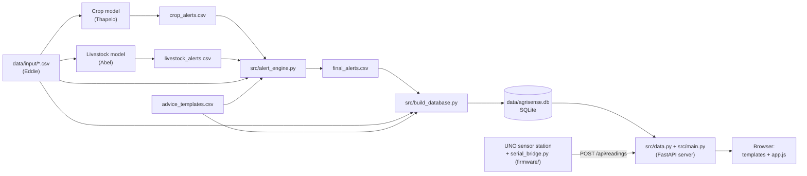
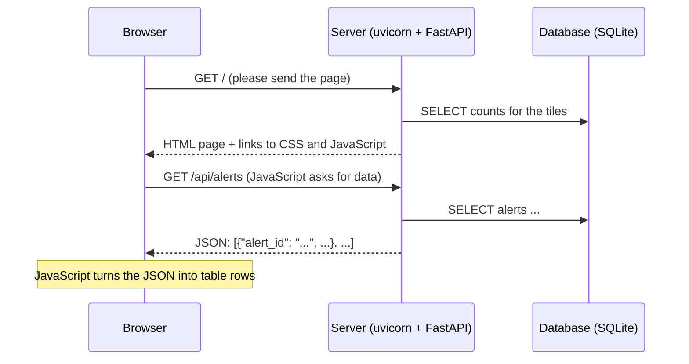

# AgriSense BW – a beginner's guide to the code

This guide explains **every part of the AgriSense BW code**, from the CSV files to the
dashboard in the browser and the small hardware prototype. It is written for team
members who have just started studying: every technical term is explained the first
time it appears, and there are worked examples with the project's real data.

You do not need to read it in one go. A good order is:

1. [The big picture](#1-the-big-picture), to know what the parts are and how they fit together
2. [Background you need](#2-background-you-need), and only the topics that are new to you
3. The part you work on: [engine](#5-part-1-the-early-warning-engine), [database](#6-part-2-the-database), [dashboard](#7-part-3-the-dashboard) or [hardware](#8-part-4-the-hardware-prototype-and-live-sensors)
4. [Two journeys through the system](#9-two-journeys-through-the-whole-system), which tie everything together

At the end there are a [cheat sheet](#10-cheat-sheet-running-things), [common tasks](#11-common-tasks-what-to-change-where),
[troubleshooting](#12-troubleshooting), [known limitations](#13-known-limitations) and a [glossary](#14-glossary).

> **A note on the data.** All crop and livestock data in this project is *simulated sample
> data*, made up to look realistic. The numbers in this guide (for example "46 alerts") are
> what the code produces with that data today.

---

## Contents

1. [The big picture](#1-the-big-picture)
2. [Background you need](#2-background-you-need)
3. [A tour of the folders](#3-a-tour-of-the-folders)
4. [The data files](#4-the-data-files)
5. [Part 1: the early-warning engine](#5-part-1-the-early-warning-engine)
6. [Part 2: the database](#6-part-2-the-database)
7. [Part 3: the dashboard](#7-part-3-the-dashboard)
8. [Part 4: the hardware prototype and live sensors](#8-part-4-the-hardware-prototype-and-live-sensors)
9. [Two journeys through the whole system](#9-two-journeys-through-the-whole-system)
10. [Cheat sheet: running things](#10-cheat-sheet-running-things)
11. [Common tasks: what to change where](#11-common-tasks-what-to-change-where)
12. [Troubleshooting](#12-troubleshooting)
13. [Known limitations](#13-known-limitations)
14. [Glossary](#14-glossary)

---

## 1. The big picture

AgriSense BW is a prototype early-warning system for farmers in Botswana. It watches two
things:

- **Crops**: will the harvest at a site be smaller than usual?
- **Livestock**: is an animal possibly ill, lost or stolen?

and turns what it finds into **alerts**: short messages that say *what* is wrong, *why*
the system thinks so, and *what to do*, in English and Setswana.

### How data flows through the system



In words:

1. Eddie's input data goes into the two models.
2. The models write their alerts as CSV files.
3. **The engine** reads both alert files (plus some input data and the advice texts) and
   writes one combined, readable file: `final_alerts.csv`.
4. **The database builder** loads all CSV files into one database file.
5. **The dashboard server** reads the database and sends web pages and data to the browser.
6. **The hardware prototype** sends live measurements to the same server.

Steps 3–5 are separate programs that you run one after the other:

```bash
python -m src.alert_engine        # step 3
python -m src.build_database      # step 4
uvicorn src.main:app --reload     # step 5, then open http://127.0.0.1:8000
```

---

## 2. Background you need

Skip any topic you already know. Each one only covers what this project uses.

### 2.1 The terminal, the "repository folder" and commands

A **repository** (or *repo*) is the project folder managed by **git**, the `AgriSenseBW`
folder. Almost every command in this guide must be run **from that folder**. In the
terminal, `cd` into it first:

```bash
cd ~/Documents/.../AgriSenseBW      # your path will differ
```

`python -m src.alert_engine` means: *run the Python module `alert_engine` inside the
package `src`*. A **module** is a `.py` file; a **package** is a folder of modules with an
`__init__.py` file (ours is `src/__init__.py`). Why `-m` instead of `python src/alert_engine.py`?
With `-m`, Python treats `src` as a package, so files inside it can import each other with
`from .build_database import ...` (the dot means "from the same package"). Running the file
directly breaks those imports, see [Troubleshooting](#12-troubleshooting).

Install the libraries the project needs once:

```bash
pip install -r requirements.txt
```

`requirements.txt` lists them: **pandas** and **numpy** (tables and maths), **fastapi**
(web framework), **uvicorn** (the web server that runs FastAPI) and **jinja2** (HTML templates).

### 2.2 Python features used everywhere

| You will see | Meaning |
|---|---|
| `OUTBREAK_MIN_ANIMALS = 3` | A **constant**. By convention, UPPERCASE names are settings that don't change while the program runs. |
| `def day(d: pd.Timestamp) -> str:` | A **function** with **type hints**: `d` should be a timestamp and the function returns a string. Python doesn't enforce hints, but they document the code (and FastAPI *does* use them, see [7.2](#72-srcmainpy-the-web-server-and-the-api)). |
| `f"{animal} (herd {herd})"` | An **f-string**: the parts in `{}` are replaced by values. `f"{x:.2f}"` shows `x` with 2 decimals. `f"{d:%b %Y}"` formats a date as e.g. `Sep 2026`. |
| `{"High": 0, "Medium": 1}` | A **dictionary** (dict): look up a value by key. `RISK_RANK["High"]` is `0`. Dicts remember the order in which keys were added. |
| `[x for x in items if x > 0]` | A **list comprehension**: builds a new list in one line. |
| `from __future__ import annotations` | Lets type hints like `str \| None` work in all Python versions. You can ignore it. |
| `if __name__ == "__main__": main()` | "Only run `main()` when this file is started as a program", not when another file imports it. |
| `raise SystemExit("message")` | Stop the program with an error message. The engine uses this when the input is wrong, rather than write a broken file. |
| `with closing(connect()) as con:` | A **context manager**: the database connection is closed automatically at the end of the block, even if an error happens. |
| `Path(__file__).resolve().parent.parent / "data"` | Build a file path. `__file__` is the current file (`src/alert_engine.py`), `.parent` is `src/`, `.parent.parent` is the repo folder, `/ "data"` adds the `data` folder. So the program finds its files wherever you start it from. |

### 2.3 pandas in five minutes

**pandas** works with **DataFrames**: tables with named columns, like a spreadsheet in
memory. The engine is written almost entirely with pandas.

```python
import pandas as pd
ld = pd.read_csv("data/input/livestock_data.csv", parse_dates=["date"])  # read a CSV into a DataFrame
ld["body_temp_c"]                      # one column (a "Series")
ld[ld["body_temp_c"] >= 39.5]          # only the rows where the condition is True ("boolean mask")
ld.sort_values(["animal_id", "date"])  # sort by animal, then date
ld.groupby("herd_id")["activity_level"].mean()   # average activity per herd
```

The operations the engine uses most:

| Operation | What it does | Example in the code |
|---|---|---|
| `groupby(...)` | Splits the table into groups (e.g. one per animal) to work on each group. | distance per animal |
| `.transform("median")` | Computes a value per group and writes it back **to every row** of the group. | herd's median position per day |
| `.shift()` | Moves values down by one row within a group: "the previous row's value". | yesterday's position |
| `.diff()` | Difference to the previous row. | days since the last alert |
| `.cumsum()` | Running total. | numbering alert episodes |
| `merge(other, on=[...])` | Joins two tables on matching columns, like SQL's JOIN. | adding advice to alerts |
| `.str.extract(regex)` | Pulls parts out of text with a regular expression. | reading Thapelo's alert text |
| `NaN` / `pd.NA` | "No value" (empty cell). | crops have no position |

### 2.4 Regular expressions (regex)

A **regular expression** is a pattern for text. The engine uses one to read Thapelo's
alert sentences. For example `(?P<pct>\d+)%` means "one or more digits, followed by `%`;
call the digits `pct`". `\d` is a digit, `+` means "one or more", `[\d.]+` means "digits and
dots", `[^:]+` means "anything except a colon", and `^`/`$` mean the start and end of the
text. A good place to try patterns is [regex101.com](https://regex101.com) (choose *Python*).

### 2.5 Databases and SQL

A **database** stores data in **tables** (like DataFrames) and answers questions about
them. We use **SQLite**: the whole database is one file, `data/agrisense.db`, and Python
can use it without installing anything. Questions are asked in **SQL**:

```sql
SELECT animal_id, body_temp_c        -- which columns
FROM livestock_data                  -- which table
WHERE date = '2026-09-30'            -- which rows
ORDER BY body_temp_c DESC;           -- sorted, highest first
```

| SQL word | Meaning |
|---|---|
| `PRIMARY KEY` | The column(s) that identify a row uniquely, e.g. `alert_id`. No two rows may share it. |
| `CHECK (...)` | A rule the database enforces, e.g. `risk_level` must be Low, Medium or High. |
| `NOT NULL` | The column may not be empty. |
| `INDEX` | A lookup structure that makes searching by that column fast. |
| `JOIN ... USING (alert_id)` | Combine rows of two tables that have the same `alert_id`. |
| `GROUP BY` | One result row per group, e.g. one count per risk level. |
| **Transaction** | A group of changes that happens completely or not at all (`BEGIN` … `COMMIT`, or `ROLLBACK` to undo). |

### 2.6 How a web app works



- The **server** is a program that waits for requests. Ours runs on your laptop at
  `http://127.0.0.1:8000` (`127.0.0.1` means "this computer", `8000` is the *port*).
- The **browser** (client) sends **HTTP requests**. Each has a **method**: `GET` (read
  something), `POST` (send new data), `PATCH` (change part of something), and a **URL**
  such as `/api/alerts?risk=High`. The part after `?` is the **query string**, which holds
  **parameters**.
- The server answers with a **status code** and a body:

  | Code | Meaning | When our server sends it |
  |---|---|---|
  | 200 | OK | normal answers |
  | 201 | Created | readings were stored |
  | 401 | Unauthorized | the sensor bridge sent the wrong key |
  | 404 | Not found | unknown alert or animal ID |
  | 422 | Unprocessable | the request data is invalid (e.g. temperature 500 °C) |

- **JSON** is the text format for data: `{"animal_id": "H3-05", "risk_level": "High"}`.
- An **API** (Application Programming Interface) is the set of URLs that return data
  instead of pages. Ours start with `/api/`.
- The page itself is built from three languages: **HTML** (structure and content),
  **CSS** (looks) and **JavaScript** (behaviour: fetching data, drawing the map, reacting to clicks).

### 2.7 Microcontrollers (only for the hardware part)

A **microcontroller** is a tiny computer on one chip that runs one program forever. We use
an **Arduino UNO**, programmed in **Arduino C++** with the Arduino IDE.

Every Arduino program (*sketch*, file ending `.ino`) has two functions:

```cpp
void setup() { /* runs once at power-on */ }
void loop()  { /* runs again and again, forever */ }
```

Terms you will meet: **I2C** (a two-wire connection, SDA and SCL, to talk to sensors),
**analog input** (reads a voltage as a number, 0–1023 on the UNO) and **serial port** (the
USB connection over which the UNO sends text to the laptop).

---

## 3. A tour of the folders

```
AgriSenseBW/
├── README.md                  short project description, layout and run commands
├── requirements.txt           Python libraries to install
├── .gitignore                 files git should not track (database file, caches, ...)
├── data/
│   ├── input/                 Eddie's sample data (the "measurements")
│   │   ├── crop_data.csv
│   │   ├── livestock_data.csv
│   │   └── public_reference_yields.csv
│   ├── alerts/
│   │   ├── crop_alerts.csv        Thapelo's crop model output
│   │   ├── livestock_alerts.csv   Abel's livestock model output
│   │   └── final_alerts.csv       the engine's combined output
│   ├── advice_templates.csv   advice texts in English and Setswana
│   ├── translations.csv       every other text of the site and the alerts, in English and Setswana
│   └── agrisense.db           the database (generated, not in git)
├── models/livestock/          Abel's notebook and chart
├── src/                       all Python code and the dashboard
│   ├── __init__.py            marks src/ as a package
│   ├── alert_engine.py        PART 1: the early-warning engine
│   ├── i18n.py                reads translations.csv (used by the engine and the dashboard)
│   ├── build_database.py      PART 2: builds the database
│   ├── data.py                PART 3: the only file that reads/writes the database
│   ├── main.py                PART 3: the web server and API (FastAPI)
│   ├── sensor_export.py       PART 4: daily summaries of live sensor data
│   ├── templates/             PART 3: HTML templates (base.html, index.html)
│   └── static/                PART 3: files sent to the browser as they are
│       ├── css/style.css      the dashboard's looks
│       ├── js/app.js          the dashboard's behaviour
│       ├── img/logo.svg       the AgriSense BW logo
│       └── vendor/            libraries we did not write: Leaflet, Chart.js, Space Grotesk font
├── firmware/                  PART 4: hardware prototype
│   ├── uno_station/           program for the Arduino UNO sensor station
│   ├── serial_bridge.py       forwards the UNO's readings to the dashboard
│   └── README.md              wiring and upload instructions
├── slides/                    presentation decks
└── doc/                       task plan, design files and this guide
```

---

## 4. The data files

### 4.1 Input data (`data/input/`, by Eddie)

**`crop_data.csv`**: 144 rows: 6 sites (Kanye, Moshupa, Jwaneng, Good Hope, Mabutsane,
Mmathethe) × 24 seasons (2001–2024), all in the Southern district.

| Column | Meaning | Example |
|---|---|---|
| `date` | end of the growing season | `2024-03-31` |
| `district`, `location` | where | `Southern`, `Kanye` |
| `rainfall_mm` | rain in the season, in millimetres | `316.7` |
| `temperature_c` | average temperature in °C | `25.81` |
| `ndvi` | *Normalised Difference Vegetation Index*: how green the plants are, 0 (bare) to 1 (very green) | `0.432` |
| `yield_t_ha` | harvest in tonnes per hectare | `0.198` |
| `data_source` | where the row comes from | `synthetic_sample` (made up) |

**`livestock_data.csv`**: 900 rows: 30 animals (herds H1, H2, H3 with 10 animals each) ×
30 days (1–30 September 2026), one reading per animal per day.

| Column | Meaning | Example |
|---|---|---|
| `date`, `animal_id`, `herd_id`, `district` | which animal, when | `2026-09-01`, `H1-01`, `H1`, `Southern` |
| `lat`, `lon` | GPS position (latitude, longitude) | `-24.98412`, `25.335911` |
| `activity_level` | how active the animal was, about 0–100 | `63.2` |
| `body_temp_c` | body temperature in °C (normal for cattle is about 38–39 °C) | `38.56` |

Eddie simulated a few animals that behave strangely: H2-04, H2-07 and H2-09 get a fever
in the second half of September, and H3-05 walks away from its herd at the end of the month.

**`public_reference_yields.csv`**: 35 rows of real national cereal yields for Botswana
(FAO data via the World Bank) for comparison. The dashboard database loads it, but no
screen uses it yet.

### 4.2 The models' outputs (`data/alerts/`)

All alert files follow the team's **shared alert format**, six columns agreed in the team plan:

`district, type (crop or livestock), risk_level (Low, Medium, High), reason, advice_en, advice_tn`

**`crop_alerts.csv`** (Thapelo, 6 rows, one per site). His model predicts each site's 2024
yield from rainfall, temperature and NDVI, compares it with the average yield, and applies
the team's rule: below 70 % of the average is **High**, 70–90 % **Medium**, above 90 %
**Low**. The numbers are packed into the `reason` text:

```
Southern,crop,Medium,"Kanye: predicted yield 0.21 t/ha is 87% of the average (0.23); rainfall 317 mm, NDVI 0.43",,
```

**`livestock_alerts.csv`** (Abel, 30 rows). His notebook (`models/livestock/`) works like this:

1. It calculates how far each animal moved each day.
2. For each herd and day, it computes the herd's average and spread (standard deviation)
   of activity and movement.
3. It computes a **z-score** per animal: *how many standard deviations the animal is away
   from its herd's average*. Example: the herd's average activity is 60 with a standard
   deviation of 10; an animal with activity 35 has z = (35 − 60) / 10 = −2.5.
4. It flags readings where:
   - activity z < −2 → "Activity unusually low compared with herd" (Medium)
   - movement z > 2 → "Movement unusually high compared with herd" (Medium)
   - low activity **and** body temperature ≥ 39.5 °C → "Low activity with high body temperature" (High)

Each row is one animal on one day, plus extra columns `date, animal_id, herd_id,
distance_km, activity_level, body_temp_c`. For example, H3-05 has five rows,
26–30 September, each "Movement unusually high compared with herd".

### 4.3 Advice texts (`data/advice_templates.csv`)

Nine rows, one for each combination of **type × category × risk level**, with the advice in
English (`advice_en`) and Setswana (`advice_tn`):

```
type,category,risk_level,advice_en,advice_tn
livestock,possible_illness,High,Check the animal promptly and contact a veterinary professional if the signs persist.,"Tlhatlhoba phologolo ka bonako, ..."
```

Keeping the texts in a CSV (instead of inside the code) means anyone can improve or
translate them without touching Python.

### 4.4 The engine's output (`data/alerts/final_alerts.csv`)

46 rows: 3 High, 24 Medium, 19 Low. The six shared columns come first, then ten extra ones:

| Column | Meaning | Example (H3-05) |
|---|---|---|
| `district`, `type`, `risk_level` | shared format | `Southern`, `livestock`, `High` |
| `reason` | plain-language explanation for farmers | "Animal H3-05 (herd H3) has moved away from its herd on 5 days in a row (26–30 Sep 2026) and is now about 29 km from it. It may be lost or stolen." |
| `advice_en`, `advice_tn` | what to do, from the templates | "This animal has been far from its herd for several days. Look for it today and report it to the police if it is missing." |
| `alert_id` | unique, stable ID | `LS-20260926-H3-05-STRAY` |
| `category` | machine-readable kind of alert | `possible_theft_or_straying` |
| `subject` | who or what it is about | `Animal H3-05 (herd H3)` |
| `for_whom` | who should act | `Farmers` (or `Veterinary services`) |
| `start_date`, `end_date`, `days` | when | `2026-09-26`, `2026-09-30`, `5` |
| `details` | the technical numbers behind the reason | "Moved 5.0–6.1 km per day vs. 0.60 km for the rest of the herd; 29.0 km from the herd's median position on 30 Sep 2026" |
| `lat`, `lon` | position (last day of the alert) | `-24.706276`, `25.424509` |

At the end come three more columns, **`subject_tn`, `reason_tn` and `details_tn`**: the same
texts in Setswana (see [4.5](#45-all-other-texts-datatranslationscsv)). For H3-05:
*"Phologolo H3-05 (letsomane H3) e tlogile mo letsomaneng la yone ka malatsi a le 5 a a
latelanang (26–30 Lwetse 2026) mme jaanong e kgakala ka 29 km. …"*

The file is saved as **UTF-8 with BOM**, a small invisible marker at the start that tells
Excel the file uses UTF-8. Without it, Excel shows `°C` as `°C`.

### 4.5 All other texts (`data/translations.csv`)

Every text you see on the dashboard (tab names, headings, buttons, messages, chart labels,
month names, …) and every sentence the engine writes has a **key** and two versions:

```
key,en,tn,tn_status
tab.crops,Crops,Dijalo,draft
sensors.collar,Collar {id},Kolara {id},draft
reason.low_activity,{who} was much less active than the rest of its herd {when}.,{who} e ne e sa tshikinyege thata go feta letsomane la yone {when}.,draft
```

- `key`: the name the code uses, e.g. `tab.crops`. The part before the dot groups texts
  (`tab.`, `alerts.`, `reason.`, …).
- `en` / `tn`: English and Setswana. Parts in **curly brackets** such as `{id}` or `{who}`
  are **placeholders**; the code fills them in (`Collar {id}` → `Collar H1-01`). Keep them
  unchanged when you translate; their order may change.
- `tn_status`: `draft` until a native speaker has checked the Setswana, then `checked`.
  While any text is a draft, the site shows "Setswana: draft translation, still being checked"
  in Setswana mode, and the engine prints a reminder.

If a Setswana text is empty, English is shown instead. The file is read by
[`src/i18n.py`](../src/i18n.py); the dashboard picks up a change on the next page load, the
engine on its next run.

---

## 5. Part 1: the early-warning engine

**File:** [`src/alert_engine.py`](../src/alert_engine.py) · **Run:** `python -m src.alert_engine`

### 5.1 What it does and why

The two models produce alerts in different shapes, with technical wording, and one row per
animal **per day** (so an animal that is flagged five days in a row appears five times).
The engine turns them into **one list that a farmer can understand**:

1. every reason is rewritten in plain language; the numbers move to `details`
2. repeated daily alerts for the same animal and problem become **one** alert
3. an animal that moves unusually far on 3 or more days in a row is raised to **High**
   ("possibly lost or stolen"), the engine's own extra rule
4. a **disease-outbreak warning** for veterinary services is added if 3 or more animals in
   one district are possibly ill within 7 days, the rule from the team plan
5. every animal without any alert gets one **Low** entry, so each animal has a risk level
   (just as every crop site has one)
6. advice in English and Setswana is added from the templates
7. every text the engine writes (subject, reason, details) is written in English **and**
   Setswana, from sentence templates in `translations.csv`
8. everything is sorted by urgency, checked and saved

### 5.2 The settings at the top

```python
OUTBREAK_MIN_ANIMALS = 3  # "3 or more animals in the same district ..."
OUTBREAK_WINDOW_DAYS = 7  # "... flagged as possibly ill within a few days"
FEVER_C = 39.5            # same value as HIGH_TEMP in the livestock notebook
STRAY_MIN_DAYS = 3        # unusual movement on this many days in a row -> High
```

These are the numbers to name in the report. Change them here and run the engine again.

Other constants:

- `SHARED_COLUMNS` / `EXTRA_COLUMNS`: the output columns in order.
- `RISK_RANK = {"High": 0, "Medium": 1, "Low": 2}`: lets the code sort and compare risk
  levels (a smaller number is more urgent).
- `LIVESTOCK_REASONS`: Abel's three reason texts and the category each one maps to,
  **most serious first**.
- `ANIMAL_CATEGORIES`: the per-animal categories and their short code for the alert ID
  (`ILL`, `MOV`, `ACT`, `STRAY`). `NORMAL_CODE = "OK"` is the code for the Low entries.
- `CROP_REASON`: the regular expression that reads Thapelo's text ([5.9](#59-crop-alerts-build_crop_alerts)).

### 5.3 The order of work: `main()`

`main()` (at the bottom of the file) runs everything in this order:

```python
ld = load_livestock_data()              # Eddie's readings + computed columns
la = load_livestock_alerts()            # Abel's alerts + a category per row
frames = [build_outbreak_alerts(la, ld),
          build_livestock_alerts(la, ld),
          build_normal_alerts(la, ld),
          build_crop_alerts()]
final = add_advice(pd.concat(frames))   # one table + advice columns
# ... sort ...
check(final, ...)                       # stop if anything looks wrong
out.to_csv(OUTPUT, ...)                 # write final_alerts.csv
report(out, la)                         # print a summary
```

`ld` and `la` are short names used throughout: **l**ivestock **d**ata and **l**ivestock **a**lerts.

### 5.4 Helper functions

| Function | What it does | Example |
|---|---|---|
| `haversine_km(lat1, lon1, lat2, lon2)` | Distance in km between two GPS points on the Earth's surface. The Earth is a ball (radius 6371 km), so you can't use Pythagoras on latitude and longitude; the *haversine formula* gives the distance along the curved surface. It works on whole columns at once (numpy). | two positions 1 km apart → `1.0` |
| `day(d, lang)` | Formats a date for people, in English or Setswana. | `26 Sep 2026` / `26 Lwetse 2026` |
| `span(start, end, days, lang)` | Describes a period in words. | `on 5 days in a row (26–30 Sep 2026)` |
| `texts(column, key, per_lang, **values)` | Fills the sentence template `key` from `translations.csv` in every language and returns the columns, e.g. `{"reason": "…", "reason_tn": "…"}` ([5.7](#57-per-animal-alerts-build_livestock_alertsla-ld)). | |
| `value_range(values, unit, digits)` | Shows the smallest and largest value, or one value if they are equal. | `5.0–6.1 km` |
| `slug(text)` | Turns text into an ID-friendly form: capital letters, digits and `-`. | `Good Hope` → `GOOD-HOPE` |

### 5.5 Preparing the livestock readings: `load_livestock_data()`

This function reads `livestock_data.csv` and **adds new columns** that the alert texts need.

```python
ld = (pd.read_csv(LIVESTOCK_DATA, parse_dates=["date"])
        .sort_values(["animal_id", "date"]).reset_index(drop=True))
```

The table is sorted by animal, then by date, so each animal's days come one after another.

**Distance moved per day.**

```python
prev = ld.groupby("animal_id")[["lat", "lon"]].shift()
ld["distance_km"] = haversine_km(prev["lat"], prev["lon"], ld["lat"], ld["lon"])
```

`groupby("animal_id")...shift()` gives each row the position of the **previous day of the
same animal** (the first day gets "no value"). The distance from yesterday's position to
today's is how far the animal walked (in a straight line). Example for H3-05:

| date | lat | lon | previous lat/lon | distance_km |
|---|---|---|---|---|
| 25 Sep | −24.925 | 25.289 | (24 Sep) | small |
| 26 Sep | −24.888 | 25.318 | −24.925, 25.289 | **5.0** |
| 27 Sep | −24.841 | 25.344 | −24.888, 25.318 | **5.9** |

**Distance from the herd.**

```python
herd = ld.groupby(["date", "herd_id"])
ld["km_from_herd"] = haversine_km(ld["lat"], ld["lon"],
                                  herd["lat"].transform("median"),
                                  herd["lon"].transform("median"))
```

For every herd and day, the **median** latitude and longitude of all its animals is the
herd's "centre". The median (the middle value) is used instead of the average because one
animal far away barely moves the median, while it would pull the average towards itself.
`km_from_herd` is how far each animal is from that centre. On 30 Sep H3-05 is about 29 km
away; every other animal stays within 1 km.

**Rest-of-herd averages.**

```python
for col in ["activity_level", "distance_km"]:
    total = herd[col].transform("sum")
    count = herd[col].transform("count")
    own = ld[col].notna().astype(int)
    ld[f"herd_{col}"] = (total - ld[col].fillna(0)) / (count - own)
```

The alert details compare an animal with **the rest of its herd**, without the animal
itself (otherwise a sick animal would pull "the herd" towards its own value). The trick:
take the herd's total, subtract the animal's own value, and divide by the number of the
*other* animals.

> Example from the data: herd H2 on 22 Sep has 10 animals with a total activity of 541.3.
> H2-07's own activity is 9.0. Rest of the herd: (541.3 − 9.0) / (10 − 1) = 59.1.

`own` is 1 if the animal has a value and 0 if not (for example the first day has no
`distance_km`), so missing values are handled correctly.

### 5.6 Reading Abel's alerts: `load_livestock_alerts()` and `classify()`

```python
la = pd.read_csv(LIVESTOCK_ALERTS, parse_dates=["date"])
la["category"] = la["reason"].map(classify)
```

`map(classify)` calls `classify` for every row's `reason` and stores the result in a new
`category` column. `classify` translates Abel's sentence into a category using
`LIVESTOCK_REASONS`:

```python
def classify(reason: str) -> str:
    parts = [part.strip() for part in str(reason).split(";")]
    unknown = [part for part in parts if part not in LIVESTOCK_REASONS]
    if unknown:
        raise SystemExit(f"Unrecognised reason in livestock_alerts.csv: {unknown}")
    order = list(LIVESTOCK_REASONS)
    return LIVESTOCK_REASONS[min(parts, key=order.index)]
```

- Abel can combine two reasons with `"; "`, so the text is split into parts.
- If a part is unknown, the engine **stops** with an error instead of guessing.
- If there are several parts, it picks the **most serious**: `order.index` is the position
  in `LIVESTOCK_REASONS` (which is written most serious first), and `min` picks the smallest
  position.

### 5.7 Per-animal alerts: `build_livestock_alerts(la, ld)`

This is the heart of the engine. It does three things.

**(a) Add context from the readings.**

```python
context = ld[["date", "animal_id", "lat", "lon", "km_from_herd",
              "herd_activity_level", "herd_distance_km"]]
la = (la.merge(context, on=["date", "animal_id"], how="left")
        .sort_values(["animal_id", "category", "date"]).reset_index(drop=True))
```

`merge` attaches to every alert row the computed columns of the same animal and day.
`how="left"` keeps every alert row, even if no reading matched.

**(b) Merge consecutive days into "episodes".**

```python
gap = la.groupby(["animal_id", "category"])["date"].diff().dt.days
la["episode"] = gap.ne(1).cumsum()
```

This two-line trick is worth understanding step by step. The rows are sorted by animal,
category and date. Within each animal + category, `diff()` gives the number of days since
the previous row (empty for the first row). `ne(1)` ("not equal to 1") is `True` whenever a
**new episode** starts: the first row, or a gap of more than one day. `cumsum()` adds up
the `True` values (True counts as 1), so every episode gets its own number:

| animal | category | date | gap (days) | gap ≠ 1? | episode |
|---|---|---|---|---|---|
| H3-05 | low_activity | 18 Sep | – | True | 7 |
| H3-05 | unusual_movement | 26 Sep | – | True | 8 |
| H3-05 | unusual_movement | 27 Sep | 1 | False | 8 |
| H3-05 | unusual_movement | 28 Sep | 1 | False | 8 |
| H3-05 | unusual_movement | 29 Sep | 1 | False | 8 |
| H3-05 | unusual_movement | 30 Sep | 1 | False | 8 |

(The episode numbers 7 and 8 are just examples; they count up across the whole table.)
So H3-05's five daily rows become **one** episode. In total, Abel's 30 rows become 25 alerts.

**(c) Build one alert per episode.**

```python
for _, ep in la.groupby("episode"):
    first, last = ep.iloc[0], ep.iloc[-1]
    ...
    start, end, days = first["date"], last["date"], len(ep)
    risk = min(ep["risk_level"], key=RISK_RANK.get)
    if category == "unusual_movement" and days >= STRAY_MIN_DAYS:
        category, risk = "possible_theft_or_straying", "High"
```

- `ep` is the table of one episode; `first` and `last` are its first and last rows.
- `risk` is the most serious risk level in the episode (smallest `RISK_RANK`).
- **The straying rule:** if the animal moved unusually far on `STRAY_MIN_DAYS` (3) or more
  days in a row, the episode becomes `possible_theft_or_straying` with risk **High**. One
  unusual day can be chance; several days in a row mean the animal is really leaving.

Then the code writes the `subject`, `reason` and `details` texts. They are not written in the
Python code but come from **sentence templates** in `translations.csv`, for example

```
reason.possible_illness: {who} has a high body temperature (up to {max_temp} °C) and is much less active than its herd {when}.
```

The code collects the **values** for the placeholders: numbers that are the same in every
language (`max_temp`, `temps`, `activity`, …), and, in a small function `per_lang(lang)`,
the parts that depend on the language (`who` = "Animal H3-05 (herd H3)" or "Phologolo H3-05
(letsomane H3)", `when` with English or Setswana month names). Then

```python
**texts("reason", f"reason.{category}", per_lang, **values)
```

fills the template once per language and returns `{"reason": "…English…", "reason_tn":
"…Setswana…"}`; the `**` puts both into the row. Finally the row, a dictionary with all
columns, is added to the list `rows`. The **alert ID** is built as
`LS-<start date>-<animal>-<code>`, e.g. `LS-20260926-H3-05-STRAY`. Because it is built only
from the animal, the problem and the start date, **the same alert gets the same ID every
time you run the engine**. The database relies on this ([6.4](#64-why-statuses-survive-a-rebuild)).

### 5.8 Low entries for animals without alerts: `build_normal_alerts()`

```python
for animal, days in ld[~ld["animal_id"].isin(la["animal_id"])].groupby("animal_id"):
```

`~` means "not": these are the readings of animals that **never** appear in Abel's file
(15 of the 30). Each gets one Low entry with category `normal` and ID ending in `-OK`, e.g.

> Animal H1-03 (herd H1) had no alerts from 1 Sep 2026 to 30 Sep 2026.

The wording deliberately says *no alerts*, not *healthy*: the livestock model can miss
animals. H2-09 is one of the 15 even though it had a fever (see [13](#13-known-limitations)).

### 5.9 Crop alerts: `build_crop_alerts()`

**Reading the numbers out of the text.** Thapelo's file has no separate columns for the
numbers, so the engine uses the regular expression `CROP_REASON`:

```
^(?P<location>[^:]+): predicted yield (?P<predicted>[\d.]+) t/ha is (?P<pct>\d+)% of the average \((?P<average>[\d.]+)\); rainfall (?P<rainfall>\d+) mm, NDVI (?P<ndvi>[\d.]+)$
```

Applied to Kanye's text it finds:

| Name | Part of the pattern | Found |
|---|---|---|
| `location` | everything before the first `:` | `Kanye` |
| `predicted` | digits and dots before ` t/ha` | `0.21` |
| `pct` | digits before `%` | `87` |
| `average` | inside the brackets | `0.23` |
| `rainfall` | digits before ` mm` | `317` |
| `ndvi` | digits and dots after `NDVI ` | `0.43` |

If any row doesn't match the pattern, the engine stops and shows the row, so a change in
Thapelo's wording is noticed immediately.

**Finding the season.** The crop alerts have no date. The engine looks in `crop_data.csv`
for the season of that site whose rainfall and NDVI match the alert (allowing for rounding:
the alert says 317 mm and 0.43, the data says 316.7 mm and 0.432). That is the 2024 season.

**Checking the rule.** It recomputes the team's rule (below 70 % High, up to 90 % Medium,
otherwise Low) and prints a note if Thapelo's level is different. Today all six agree.

**Writing the alert.** `crop_reason_key()` picks the sentence template: by risk for High and
Medium, and for Low by whether the harvest is above, equal to or near the average. For Kanye
(87 %, Medium) it is `reason.crop.Medium`: *"The harvest in Kanye is expected to be about 13%
smaller than the district average."* (Setswana: *"Thobo kwa Kanye e solofelwa go nna nnye ka
13% go feta palogare ya kgaolo."*). The ID is `CR-<year>-<site>`, e.g. `CR-2024-KANYE`.

### 5.10 The outbreak rule: `find_outbreaks()` and `build_outbreak_alerts()`

The team plan says: *if 3 or more animals in the same district are flagged as possibly ill
within a few days, create a High outbreak warning for veterinary services.*

`possibly_ill(la)` takes the rows of Abel's file with category `possible_illness`. Then
`find_outbreaks` checks, district by district and day by day:

```python
for today in sorted(rows["date"].unique()):
    recent = rows[(rows["date"] > today - window) & (rows["date"] <= today)]
    if recent["animal_id"].nunique() >= min_animals:
        ...  # start or continue a cluster
    elif current is not None:
        ...  # the cluster has ended
```

For each day with an illness flag, `recent` is the last 7 days (a **sliding window**), and
`nunique()` counts the **different** animals in it (one animal flagged on three days still
counts once). If there are at least 3, an outbreak cluster starts (or continues).

With today's data:

| Date | Possibly ill (Abel) | Different animals in the last 7 days | Outbreak? |
|---|---|---|---|
| 19 Sep | H2-04 | 1 | no |
| 20 Sep | H2-04 | 1 | no |
| 22 Sep | H2-07 | 2 (H2-04, H2-07) | no, 2 < 3 |

So **no outbreak warning** is produced. If H2-09 had also been flagged, for example on
23 Sep, there would be 3 different animals within 7 days and the engine would create a
High alert `OB-20260923-SOUTHERN` for veterinary services, saying the animals have shown
signs of illness since 19 Sep. The rule is ready; it just has nothing to fire on.

`build_outbreak_alerts` turns each cluster into an alert. `for_whom` is
`Veterinary services`, the position is the average position of the sick animals, and the
details list their highest temperatures.

### 5.11 Advice: `add_advice()`

```python
merged = alerts.merge(templates, on=["type", "category", "risk_level"], how="left")
```

Every alert is matched with the template row that has the same type, category and risk
level, which adds `advice_en` and `advice_tn`. Two safety checks: if the template file has
**two** rows for the same combination, or an alert finds **no** row, the engine stops and
says which combination is the problem.

### 5.12 Sorting, checking and writing

**Sorting.**

```python
final["_outbreak_last"] = (final["category"] != "disease_outbreak").astype(int)
final["_risk"] = final["risk_level"].map(RISK_RANK)
final = final.sort_values(["_outbreak_last", "_risk", "start_date", "alert_id"],
                          ascending=[True, True, False, True])
```

Two temporary helper columns make the order: outbreak warnings first (0 before 1), then
High → Medium → Low (0, 1, 2), then **newest first** (`start_date` descending), then by ID
so the order is always the same. The helper columns are removed afterwards.

**`check()`** refuses to write the file if anything is wrong:

- every `alert_id` is unique
- `type` is only crop/livestock, `risk_level` only Low/Medium/High
- no empty district, type, risk level, reason or English advice
- all 6 crop alerts are still there
- the merged per-animal alerts cover exactly as many animal-days as Abel's file has rows
  (30), so merging lost nothing
- every one of the 30 animals has at least one entry

**Writing.** Dates become text like `2026-09-26`, `days` becomes a whole number that may be
empty (`Int64`, because crop alerts have no `days`), positions are rounded to 6 decimals,
and the file is saved with `encoding="utf-8-sig"` (the BOM, see [4.4](#44-the-engines-output-dataalertsfinal_alertscsv)).

### 5.13 The console report: `report()`

After writing, the engine prints a summary. Today it is:

```
Wrote final_alerts.csv: 46 alerts (High 3, Medium 24, Low 19)
  crop: 6, livestock: 25 (from 30 daily alerts) + 15 Low for animals without alerts, outbreak warnings: 0
  outbreak rule input: possible-illness flags in livestock_alerts.csv
  Note: H2-09 is Low (no alerts in livestock_alerts.csv) but had a body temperature of 39.5 °C or more on 8 days (23 Sep 2026 to 30 Sep 2026).
  no outbreak: possibly ill animals are H2-04, H2-07 (2 < 3)
```

Line by line: the totals; where they come from; which input the outbreak rule uses; a
warning about an animal that is Low but had a fever (so nobody overlooks it); and why no
outbreak warning was created. If any advice template had no Setswana text, a warning
listing those templates would appear at the end.

---

## 6. Part 2: the database

**File:** [`src/build_database.py`](../src/build_database.py) · **Run:** `python -m src.build_database`

### 6.1 Why a database at all?

The dashboard could read the CSV files directly. A database adds three things:

1. **Fast, flexible questions.** "All High alerts of herd H2 that are still open" is one
   SQL query.
2. **Data that changes in the dashboard.** When someone marks an alert as *acknowledged*,
   that has to be saved somewhere. Writing back into CSV files that other programs
   regenerate would be fragile.
3. **Live sensor readings** from the hardware are stored as they arrive.

### 6.2 The tables

| Table | Filled from | Rebuilt each run? | Notes |
|---|---|---|---|
| `alerts` | `final_alerts.csv` | yes | including the Setswana columns `subject_tn`, `reason_tn`, `details_tn`; plus a column `animal_id`, read from the ID (`LS-20260926-H3-05-STRAY` → `H3-05`) |
| `crop_data` | `crop_data.csv` | yes | key: site + date |
| `livestock_data` | `livestock_data.csv` | yes | key: animal + date; index on date for the map |
| `reference_yields` | `public_reference_yields.csv` | yes | |
| `advice_templates` | `advice_templates.csv` | yes | key: type + category + risk level |
| `alert_status` | the dashboard | **never dropped** | `alert_id`, `status` (open / acknowledged / resolved), `updated_at` |
| `sensor_readings` | the UNO station (via the bridge) | **never dropped** | one row per live reading ([8.4](#84-the-server-side-receiving-storing-showing)) |

The table definitions are written in SQL at the top of the file (`SCHEMA`,
`STATUS_SCHEMA`, `SENSOR_SCHEMA`), for example:

```sql
CREATE TABLE alerts (
    alert_id    TEXT PRIMARY KEY,
    ...
    type        TEXT NOT NULL CHECK (type IN ('crop', 'livestock')),
    risk_level  TEXT NOT NULL CHECK (risk_level IN ('Low', 'Medium', 'High')),
    ...
);
```

The `CHECK` rules mean the database itself refuses wrong values, a second line of defence
after the engine's `check()`.

### 6.3 How `build()` works

```python
con = sqlite3.connect(path, isolation_level=None)
con.execute("BEGIN IMMEDIATE")
try:
    for table in SOURCES:
        con.execute(f"DROP TABLE IF EXISTS {table}")   # 1. remove the old data tables
    ... create the tables from SCHEMA ...              # 2. create them again
    ensure_live_tables(con)                            # 3. alert_status + sensor_readings, only if missing
    for table, df in frames.items():
        insert(con, table, df)                         # 4. copy the CSV rows in
    con.executemany("INSERT OR IGNORE INTO alert_status ...")   # 5. new alerts start as "open"
    con.execute("COMMIT")
except BaseException:
    con.execute("ROLLBACK")
    raise
```

- **One transaction.** Everything between `BEGIN` and `COMMIT` happens completely or not
  at all. If, say, a CSV contains a value the `CHECK` rules reject, `ROLLBACK` undoes all
  changes and **the previous database stays as it was**. `isolation_level=None` tells Python
  "I'll manage the transaction myself".
- **Why drop and recreate?** The data tables are copies of the CSV files. Recreating them
  is the simplest way to make sure the database matches the files exactly.
- `insert()` converts empty pandas values (`NaN`) to `None`, which SQLite stores as
  `NULL` (empty).
- The database file is `data/agrisense.db`, unless the environment variable `AGRISENSE_DB`
  names another path (`db_path()`). That is handy for testing with a copy.
- It prints the number of rows per table: 46 alerts, 144 crop rows, 900 livestock rows,
  35 reference yields, 9 templates, plus the statuses and sensor readings.

### 6.4 Why statuses survive a rebuild

`alert_status` is created with `CREATE TABLE IF NOT EXISTS` and is never dropped. Step 5
adds a row with status `open` only for alert IDs that are not in the table yet
(`INSERT OR IGNORE` means "skip if that `alert_id` already exists").

So if you mark `LS-20260926-H3-05-STRAY` as *acknowledged* in the dashboard, then rerun the
engine and the database builder, the alert gets **the same ID** again (see
[5.7](#57-per-animal-alerts-build_livestock_alertsla-ld)) and its status stays *acknowledged*.

### 6.5 Looking inside the database yourself

macOS includes the `sqlite3` tool:

```bash
sqlite3 data/agrisense.db
```

```sql
.tables                                    -- list the tables
.headers on
SELECT alert_id, risk_level FROM alerts WHERE risk_level = 'High';
SELECT status, COUNT(*) FROM alert_status GROUP BY status;
.quit
```

A program with a graphical interface is [DB Browser for SQLite](https://sqlitebrowser.org).

> **Important:** the dashboard reads the **database**, not the CSV files. After running the
> engine, also run `python -m src.build_database`, or the dashboard keeps showing the old
> alerts.

---

## 7. Part 3: the dashboard

The dashboard is a small website that runs on your laptop. It has four tabs: **Crops**,
**Livestock**, **Alerts** and **Sensors**.

```
Browser                                 Server (your laptop)
───────                                 ────────────────────
index.html  ◄──── GET / ───────────────  main.py: index()  ──► data.summary()
style.css   ◄──── GET /static/... ─────  StaticFiles
app.js      ◄──── GET /static/... ─────  StaticFiles
   │
   └─ fetch /api/alerts ───────────────► main.py: get_alerts() ──► data.alerts() ──► SQLite
      ◄──── JSON ──────────────────────
```

Three layers, each in its own file:

| Layer | File | Job |
|---|---|---|
| **Data access** | `src/data.py` | the *only* file that talks to the database; returns plain lists and dicts |
| **Web server / API** | `src/main.py` | receives requests, checks parameters, calls `data.py`, returns JSON or the page |
| **Front end** | `src/templates/*.html`, `src/static/js/app.js`, `src/static/css/style.css` | what runs in the browser |

Keeping the database code in one file means you could replace SQLite with another database
(e.g. PostgreSQL) by changing only `data.py`.

### 7.1 Starting the server

```bash
uvicorn src.main:app --reload
```

`uvicorn` is the web server. `src.main:app` means "the variable `app` in the module
`src.main`". `--reload` restarts the server automatically when you change a Python file.
Open http://127.0.0.1:8000 in the browser. Stop the server with `Ctrl+C`.

The sensor bridge runs on the same laptop, so the dashboard doesn't need to be reachable from
other devices. (`--host 0.0.0.0` would allow that, e.g. for a board sending over Wi-Fi.)

### 7.2 `src/main.py`: the web server and the API

**File:** [`src/main.py`](../src/main.py)

**The app and its folders.**

```python
app = FastAPI(title="AgriSense BW", ...)
app.mount("/static", StaticFiles(directory=HERE / "static"), name="static")
templates = Jinja2Templates(directory=HERE / "templates")
```

- `app` is the web application. FastAPI generates interactive API documentation at
  http://127.0.0.1:8000/docs, where you can try every endpoint.
- `mount("/static", ...)`: every file under `src/static/` is served as it is, e.g.
  `src/static/js/app.js` at `/static/js/app.js`.
- `templates`: HTML files with placeholders that are filled in on the server ([7.4](#74-the-html-templates)).

**Language.** `index()` decides the page's language: a link like `/?lang=tn` wins, otherwise
the cookie `lang` that the language switch sets, otherwise English (`i18n.language()` only
accepts `en` and `tn`). It hands the templates:

- `t(key, **values)`: a text in that language, e.g. `t('tab.crops')` → `Dijalo`
- `day_label(iso)`: a date for the day menu, e.g. `Wed 30 Sep 2026` / `Laboraro 30 Lwetse 2026`
- `strings`: **all** texts in that language, which `base.html` passes on to `app.js`
- `tn_drafts`: whether to show the "draft translation" note

One more helper is available to all templates:

- `version(path)`: returns the time the file was last changed. The templates add it to the
  CSS and JavaScript links (`app.js?v=1791843260`). When the file changes, the link changes,
  so the browser loads the new file instead of an old copy from its cache.

**Routes (endpoints).** A route connects a URL and method to a Python function, with a
**decorator** (the `@` line above the function):

```python
@app.get("/api/alerts", tags=["alerts"])
def get_alerts(type: AlertType | None = None,
               risk: Annotated[list[Risk] | None, Query()] = None,
               status: Status | None = None, since: dt.date | None = None) -> list[dict]:
    return data.alerts(type=type, risk=risk, status=status,
                       since=since.isoformat() if since else None)
```

FastAPI reads the **type hints** to understand the parameters:

- `type: AlertType | None = None` → an optional query parameter `?type=...`. `AlertType` is
  `Literal["crop", "livestock"]`, so any other value is rejected with **422**.
- `risk: Annotated[list[Risk] | None, Query()]` → may appear several times:
  `?risk=High&risk=Medium`.
- `since: dt.date` → must be a valid date like `2026-09-20`.
- The returned list of dicts is automatically converted to JSON.

All endpoints:

| Method + URL | Function | Returns / does |
|---|---|---|
| `GET /` | `index()` | the dashboard page (HTML), with the tile numbers filled in |
| `GET /api/summary` | `get_summary()` | counts for the tiles: open alerts per risk, crop sites at risk, animals with alerts, outbreaks, … |
| `GET /api/alerts?type=&risk=&status=&since=` | `get_alerts()` | alerts with their status, most urgent first |
| `PATCH /api/alerts/{alert_id}/status` | `update_status()` | saves a new status; body `{"status": "acknowledged"}`; **404** if the ID is unknown |
| `GET /api/livestock/positions?date=` | `get_positions()` | every animal's position on that day (default: the last day) and its alerts so far; **404** for a day without data |
| `GET /api/livestock/{animal_id}` | `get_animal()` | one animal's 30 days of readings, the rest-of-herd activity and its alerts; **404** if unknown |
| `GET /api/crops` | `get_crops()` | yield per site and season, the district average, the crop forecasts |
| `POST /api/readings` | `post_readings()` | receives live readings from the sensor bridge, **201** ([8.4](#84-the-server-side-receiving-storing-showing)) |
| `GET /api/sensors/live?minutes=10` | `get_live_sensors()` | latest state of collars and rain sensor, with recent history |
| `GET /api/sensors/daily` | `get_sensor_days()` | daily summaries of the live readings |

`{alert_id}` in a URL is a **path parameter**: in `/api/alerts/CR-2024-KANYE/status`, the
function receives `alert_id = "CR-2024-KANYE"`.

**Request bodies with Pydantic.** For `PATCH` and `POST`, the data comes as JSON in the
request body. A **Pydantic model** describes what it must look like:

```python
class StatusUpdate(BaseModel):
    status: Status        # Literal["open", "acknowledged", "resolved"]
```

FastAPI checks the incoming JSON against the model; `{"status": "deleted"}` is rejected
with 422 before our code even runs.

**Errors.** `raise HTTPException(404, "No alert with ID ...")` sends a 404 answer with
that message.

**Try it** (server running) in a second terminal:

```bash
curl "http://127.0.0.1:8000/api/alerts?risk=High"
curl -X PATCH http://127.0.0.1:8000/api/alerts/CR-2024-KANYE/status \
     -H "Content-Type: application/json" -d '{"status": "acknowledged"}'
```

### 7.3 `src/data.py`: talking to the database

**File:** [`src/data.py`](../src/data.py)

**Connecting.**

```python
def connect() -> sqlite3.Connection:
    path = db_path()
    if not path.exists():
        build(path)                  # no database yet? build it from the CSVs
    con = sqlite3.connect(path)
    con.row_factory = sqlite3.Row    # rows can be read like dicts: row["alert_id"]
    ensure_live_tables(con)          # add alert_status / sensor_readings if missing
    return con

def query(sql, params=()):
    with closing(connect()) as con:
        return [dict(row) for row in con.execute(sql, params)]
```

Every function opens a fresh connection for each request, so a database you just rebuilt is
used immediately, without restarting the server.

**Parameters instead of pasting values into SQL.** The functions never write user input
directly into the SQL text. They use `?` placeholders:

```python
query("SELECT ... FROM livestock_data WHERE date = ?", (date,))
```

SQLite inserts the value safely. Pasting text into SQL (`f"... WHERE date = '{date}'"`)
would allow **SQL injection**: someone could send a "date" containing SQL commands.

**The functions:**

| Function | What it does |
|---|---|
| `alerts(type, risk, status, since, animal_id)` | Builds the `WHERE` part from the filters that are set, joins `alerts` with `alert_status`, and sorts with `ALERT_ORDER` (outbreaks first, then High → Medium → Low, newest first). |
| `set_status(alert_id, status)` | `UPDATE alert_status ...`; returns the updated alert, or `None` if the ID doesn't exist (→ 404). |
| `summary()` | All numbers for the tiles, each one small SQL query. "Animals with alerts" doesn't count the Low "no alerts" entries. |
| `livestock_dates()` | The 30 days that have readings (for the day menu). |
| `positions(date)` | Each animal's position on that day, plus its alerts that **started on or before** that day (not counting the Low entries). It returns `risk_level` (the most serious of those alerts), the list of `alerts`, and two flags, `flagged` (an alert covers that day) and `earlier_alert`. The current map only uses `risk_level` and `alerts`. |
| `animal(animal_id)` | 30 days of readings. A small SQL *subquery* computes the rest-of-herd average activity per day; Python adds the distance moved per day with `haversine_km`. |
| `crops()` + `crop_prediction()` | The crop seasons and the district average; reads each forecast's predicted yield and percentage back out of the alert's `details` text with a regex. |
| `store_readings()`, `live_sensors()`, `sensor_days()` | Live sensor data, see [8.4](#84-the-server-side-receiving-storing-showing). |

A detail in `set_status`: `with closing(connect()) as con, con:` uses the connection twice.
`closing(...)` closes it at the end; the second `con` (a connection used as a context
manager) **commits** the change if no error happened, or rolls it back otherwise.

### 7.4 The HTML templates

**Files:** [`src/templates/base.html`](../src/templates/base.html), [`src/templates/index.html`](../src/templates/index.html)

The templates use **Jinja2**. Normal HTML, plus:

| Syntax | Meaning | Example |
|---|---|---|
| `{{ ... }}` | insert a value | `{{ summary.open_by_risk.High }}` → `3` |
| `` | logic: loops, conditions, blocks | `...` |
| `{{ t('tab.crops') }}` | a text in the page's language | `Crops` / `Dijalo` |
| `{{ url_for('static', path='css/style.css') }}` | link to a static file | `/static/css/style.css` |

**Inheritance.** `base.html` is the frame: `<head>`, fonts, CSS, the `<script>` tags
for Leaflet and Chart.js, and `<script id="i18n-data" type="application/json">`, which
contains all texts in the page's language for `app.js` (`tojson` turns the Python dict into
safe JSON). `<html lang="en">` or `lang="tn"` tells browsers and screen readers the language. `index.html` starts with `` and fills the
`` with the actual page.

**What `index.html` contains**, from top to bottom:

1. **The top bar**: logo, the four tab buttons, the **English / Setswana switch** and the
   "Sample data" pill. **No text is written directly in the HTML**: every visible word is
   `{{ t('…') }}`, so the whole page follows the language.
2. **The overview tiles**: High open, Medium open, crop sites at risk, animals with alerts,
   outbreak warnings. These numbers are filled in **on the server** (from `data.summary()`),
   so they appear instantly.
3. **Four `<section>` panels**, one per tab. Only one is visible at a time; the others have
   the `hidden` attribute. Most of their content (table rows, map, charts) is **empty in the
   HTML** and filled in by `app.js` with data from the API.

The tabs follow the accessibility pattern for tabs: `role="tab"`, `aria-selected`,
`aria-controls`. This lets screen readers and the keyboard (arrow keys) use them.

### 7.5 `src/static/js/app.js`: the dashboard's behaviour

**File:** [`src/static/js/app.js`](../src/static/js/app.js)

This file is plain JavaScript, no framework. It runs once when the page has loaded and is
organised in sections: helpers, tabs, alerts, livestock, crops, sensors, start.

#### Language

```javascript
const I18N = JSON.parse(document.getElementById("i18n-data").textContent);
function t(key, values = {}) { ... }       // t("sensors.collar", { id: "H1-01" }) -> "Collar H1-01"
const loc = (alert, field) => ...;         // loc(alert, "reason") -> reason_tn in Setswana mode
```

- `I18N` is the dictionary of all texts that the server put into the page, already in the
  page's language. `t()` looks a key up and fills the `{placeholders}`, exactly like
  `i18n.say()` in Python. Every text the JavaScript writes goes through `t()`.
- `loc(alert, "reason")` returns the alert's Setswana column (`reason_tn`) in Setswana mode,
  and the English one otherwise or if the Setswana is missing.
- **The switch** (English / Setswana buttons) stores the choice in the cookie `lang` and
  reloads the page; the server then renders everything in the new language. The open tab
  stays open, because it is remembered in `localStorage`.

#### Helpers at the top

```javascript
const $ = (sel, root = document) => root.querySelector(sel);   // $("#alert-rows") finds an element
const esc = (text) => String(text ?? "").replace(/[&<>"']/g, ...);
async function api(path, options) {
  const res = await fetch(path, options);
  if (!res.ok) throw new Error(`${res.status} ${await res.text()}`);
  return res.json();
}
```

- `$` is a shortcut for finding one element of the page by a CSS selector.
- **`esc` is important for security.** Before data is put into the page as HTML, characters
  like `<` are replaced by `&lt;`. Without this, a text containing `<script>` would run as
  code in the browser (**cross-site scripting**, XSS). Every value that goes into
  `innerHTML` passes through `esc`.
- `api(path)` asks the server for JSON. `fetch` sends the request; `await` waits for the
  answer without freezing the page (that's what `async` functions are for). If the server
  answers with an error code, `api` throws an error.
- `COLORS` holds the colours (the same as in the CSS), `CATEGORY_LABELS` the display names
  of the categories, and `badge(risk)` makes the coloured High/Medium/Low label.

#### Tabs

`selectTab(tab)` shows the chosen panel, hides the others, remembers the choice in
`localStorage` (the browser's small storage, so a reload opens the same tab), and calls the
tab's start function from `onShow`. The Livestock and Crops tabs are only built the first
time they are opened, which keeps the start fast. The Sensors tab starts and stops its
automatic refresh.

At the very end of the file, the start tab is chosen: a link like `/#livestock` opens that
tab; otherwise the last one used; otherwise Alerts.

#### The Alerts tab

1. `loadAlerts()` reads the filter menus (type, risk, status), asks `/api/alerts?...` and
   calls `renderAlerts()`.
2. `renderAlerts()` builds one table row per alert: risk badge, subject and category, the
   reason with expandable details (both via `loc()`, so in the page's language), the advice
   (`advice()` takes `advice_tn` in Setswana mode), the dates (`when()`), and a status menu.
3. When a filter changes, the list is loaded again.
4. When a status menu changes, the code sends `PATCH /api/alerts/<id>/status` and reloads
   the list and the tiles.

The status menus are not given one event handler each. There is **one** handler on the
table body (`#alert-rows`) that checks which menu was changed (`e.target.closest(...)`).
This is called **event delegation**, and it keeps working after the rows are redrawn.

#### The Livestock tab: the map

The map uses **Leaflet**, a library for interactive maps:

| Leaflet concept | In our code |
|---|---|
| `L.map("map")` | the map, inside `<div id="map">` |
| `L.tileLayer(...)` | the background map from OpenStreetMap, loaded as small image tiles from the internet |
| `L.layerGroup()` | a container of things on the map: `markerLayer` (the dots) and `trackLayer` (the dashed path) |
| `L.marker(..., { icon: L.divIcon(...) })` | a dot; `divIcon` means the dot is an HTML element styled by CSS (`.dot-marker`) |
| `bindTooltip(...)` | a label next to a dot ("H3-05") |
| `fitBounds`, `flyTo`, `flyToBounds` | move the view: show everything, or fly to one animal |
| `map.on("zoom", ...)` | run code when the zoom changes |

What happens when the tab opens:

1. `initLivestock()` creates the map once, with the tile layer, the two layer groups and the
   **"Show all animals"** button (a custom Leaflet control, `ShowAllControl`).
2. `loadPositions()` asks `/api/livestock/positions?date=...` for the chosen day. For animals
   with a straying alert (`-STRAY`), it also loads their 30 days of positions once, to draw
   the path. It updates the counts next to the filter buttons.
3. `renderMap()` draws the dashed paths and one dot per visible animal:
   - The **colour is the risk level**: red High, amber Medium, green Low.
     `riskOf(animal)` is the animal's most serious alert so far, or Low if it has none.
   - High dots are larger and have a clickable name label.
   - The dots are drawn in order Low → Medium → High, so the important ones are on top.
4. `renderChips()` fills the "Animals by risk" list next to the map, grouped by risk.

**The filter** (High / Medium / Low chips above the map). Each chip contains a hidden
checkbox; changing it updates the set `shownRisks` and redraws the map and the list.

**Choosing an animal.** Clicking a dot, its label or its button in the list calls
`toggleAnimal(id)`:

- If it was not chosen yet, `showAnimal(id)`:
  - marks it (`markSelection()` adds a dark ring and highlights the list button)
  - flies the map to it (`focusAnimal()`, zoom 15)
  - loads `/api/livestock/<id>` and shows its numbers and two charts: body temperature
    with the 39.5 °C fever line, and its activity next to the rest of the herd.
- If it was already chosen, or you press "Show all animals", `showAllAnimals()` deselects
  it and zooms back out.

`showAnimal` checks `if (selectedAnimal !== id) return;` after loading. If you click
another animal while the first one is still loading, the old answer is ignored.

**Two details about smooth zooming:**

- **Dots that scale with the zoom.** On every zoom step, `scaleDots()` sets the CSS variable
  `--dot-scale` on the map (between 0.85 and 1.7), and the CSS scales all dots with it.
  Dots grow a little when you zoom in.
- **The path fades during a flight.** Leaflet stretches its drawing layer during a "fly"
  animation and redraws it only at the end, which made the path look strange. `flying()`
  adds the class `flying` to the map until the movement ends, and the CSS fades that layer
  out meanwhile.

**Changing the day** moves all dots to that day's positions; if you are zoomed in on an
animal, the map follows it.

#### The Crops tab

`initCrops()` loads `/api/crops` and builds:

- A **line chart** (Chart.js) of yield per season for the six sites. Six coloured lines on
  top of each other are hard to read, so one site at a time is highlighted in blue and the
  others are grey. The buttons above the chart switch the highlighted site
  (`highlightSite()`); the dashed line is the district average.
- The **2024 forecast table**, sorted from the lowest to the highest % of average.

`lineChart(canvas, datasets, yTitle)` is a small helper that creates every line chart with
the same settings, so all charts look alike.

#### The Sensors tab

`startSensors()` calls `loadSensors()` immediately and then every 3 seconds
(`setInterval`); `stopSensors()` stops this when you leave the tab, so the page doesn't keep
asking the server in the background. `loadSensors()` asks `/api/sensors/live`:

- The status line shows whether the sensor station is sending and when it last sent data.
- `renderRain()` shows "Raining" or "Dry" and a bar for how wet the sensor is.
- `renderCollars()` shows one card per collar, with a status badge (**High temperature**,
  **Not seen** or **OK**), the values, and a chart of the last 10 minutes. The cards and
  charts are created once and then only updated, so they don't flicker. The chart's x-axis
  is real time (the last 10 minutes up to now), with the demo temperature threshold as a
  dashed line.

### 7.6 `src/static/css/style.css`: the looks

**File:** [`src/static/css/style.css`](../src/static/css/style.css)

- **Design tokens.** At the top, `:root { --primary: #1D2B36; --accent: #3A86C8; ... }`
  defines the colours of the "Sorghum Alert" brand (from the design file in `doc/`) as
  **CSS variables**. The rest of the file uses `var(--accent)` etc., so a colour is changed
  in one place.
- **Font.** `@font-face` loads Space Grotesk from `static/vendor/`, so it works without
  internet.
- **Layout.** CSS *flexbox* (`display: flex`) for rows of things like tiles and chips,
  CSS *grid* (`display: grid`) for the two-column Livestock and Crops layouts.
- **Responsive design.** `@media (max-width: 1100px)` and `@media (max-width: 640px)`
  rules switch to one column and smaller text on narrow screens.
- **Accessibility.**
  - Risk is never shown by colour alone: badges also have a word and a symbol (▲ High,
    ◆ Medium, ● Low, added with `::before`), for colour-blind users and weak projectors.
  - Keyboard focus is shown with a clear outline (`:focus-visible`).
  - The text is set large on purpose, because the dashboard is shown on a projector.

### 7.7 Libraries in `static/vendor/`

| Library | What for |
|---|---|
| Leaflet 1.9.4 | the interactive map |
| Chart.js 4.4.7 | the line charts |
| Space Grotesk (font, SIL Open Font License) | the brand font |

They are stored in the project instead of being loaded from the internet, so the dashboard
works without a connection, which matters at a booth with bad Wi-Fi. Only the map's
background tiles need internet; without them the dots still appear on a plain background.

---

## 8. Part 4: the hardware prototype and live sensors

**Folder:** [`firmware/`](../firmware/README.md) (wiring and upload instructions are in its README)

```
 UNO sensor station              USB      Laptop
 Arduino UNO                   ────────►  serial_bridge.py  ──►  FastAPI dashboard
 + Flying Fish rain sensor                                       POST /api/readings
 + GY-906 infrared thermometer                                   → Sensors tab
```

The UNO has no Wi-Fi, so the readings take a detour through the laptop: the UNO prints them
over USB, and a small Python script forwards them to the server.

The GY-906 we have is probably faulty (see "Limits" in `firmware/README.md`). Its air
temperature is right, but its skin temperature mostly isn't.

### 8.1 The parts

| Part | What it is | Role |
|---|---|---|
| **Arduino UNO** | simple microcontroller board with labelled pins, no Wi-Fi | the "sensor station", connected to the laptop by USB |
| **Flying Fish** rain sensor | a plate whose electrical resistance drops when wet, plus a small control board | rain yes/no and how wet |
| **GY-906** (MLX90614) | infrared thermometer: measures the temperature of whatever it points at, without contact, plus its own (air) temperature | skin temperature |

### 8.2 The UNO program: `firmware/uno_station/uno_station.ino`

**`setup()`** (runs once) prepares the pins and checks whether the GY-906 answers. It prints
`# GY-906 found` or a hint about the wiring. Lines starting with `#` are messages for people.

**`loop()`** (runs forever) measures every 2 seconds:

1. `readRainRaw()` switches the rain sensor on through pin 7, waits 50 ms, reads A0 eight
   times and averages it, and switches the sensor off again. Powering it only while
   measuring slows down corrosion of the plate. The raw value (about 1000 = dry, lower = wet)
   becomes a **level 0–100** with `map()`; from level 20 on it counts as raining.
2. `readMlx()` reads the GY-906 twice: the temperature of what it points at (register `0x07`,
   the "skin") and its own temperature (`0x06`, the air).
3. It **prints one line of JSON** with both readings, e.g.
   `{"readings":[{"sensor":"rain","rain_level":2,"rain_raw":1004,"rain_wet":false},{"sensor":"collar","animal_id":"H1-02","body_temp_c":null,"ambient_c":23.09,"activity":null,"rssi":null}]}`.
   The GY-906 is sent as a "collar" with the ID `H1-02`, because the dashboard shows
   temperatures per animal. Missing values are `null`.

**Reading the GY-906.** The sensor speaks I2C (more exactly SMBus). The UNO sends the number
of a *register* and gets three bytes back: the value, low byte first, and a checksum (PEC, a
CRC-8, computed by `crc8()`). The value counts in steps of 0.02 kelvin, so
°C = value × 0.02 − 273.15. Answers are thrown away if the checksum is wrong, if the error bit
is set, or if the value is 0 (the sensor has just started).

**Software I2C.** The UNO's I2C hardware (the `Wire` library) got no answer from our GY-906 at
any speed. So the program drives the two wires itself ("bit banging"): `busStart()`,
`busWrite()`, `busRead()` and `busStop()` produce the I2C signals step by step, with 10 µs
pauses. The pins act as **open drain**: they only pull a line low (`OUTPUT`, `LOW`) or let go
of it (`INPUT`), and the sensor board's resistors pull it high. This sensor also only answers
right after one pass over all I2C addresses, so every reading starts with `mlxWake()`, which
does exactly that.

**Plausibility.** `plausible()` drops temperatures outside −20 to 80 °C. Our GY-906 sometimes
reports skin temperatures such as −170 °C with a valid checksum; these are sent as `null`.

### 8.3 The bridge: `firmware/serial_bridge.py`

```bash
python firmware/serial_bridge.py
```

The script runs on the laptop next to the dashboard:

1. `find_port()` looks for the UNO among the serial ports (by the USB vendor number of
   Arduino boards). If it's not clear which port it is, you pass `--port`.
2. It opens the port with **pyserial** at 115200 baud and reads line by line. Opening the
   port restarts the UNO, which is normal.
3. For every JSON line it builds the message the server expects, adding the station's name
   (`gateway_id`, default `uno-station`) and position (`--lat`, `--lon`):

   ```json
   {"gateway_id": "uno-station", "lat": -24.98, "lon": 25.34,
    "readings": [
      {"sensor": "rain", "rain_level": 2, "rain_raw": 1004, "rain_wet": false},
      {"sensor": "collar", "animal_id": "H1-02", "body_temp_c": null, "ambient_c": 23.09,
       "activity": null, "rssi": null}
    ]}
   ```

4. `post()` sends it to `POST /api/readings` with Python's `urllib`, with the key in the
   header `X-Sensor-Key` if `--key` is given, and prints a short summary and the server's
   answer (`201`).

Lines starting with `#` are printed but not sent. If the UNO is unplugged, the script waits
and tries again every 3 seconds.

### 8.4 The server side: receiving, storing, showing

**Receiving: `POST /api/readings`** (in `main.py`). Three Pydantic models describe the
JSON above: `ReadingBatch` (the whole message), with a list of `CollarReading` or
`RainReading`. The field `sensor` decides which one applies (a *discriminator*). They
check, for example:

- the animal ID: 1–6 letters, digits or `-`
- temperatures between −40 and 100 °C, activity 0–100
- at most 50 readings per message

Anything else is rejected with **422**. If the environment variable `AGRISENSE_SENSOR_KEY`
is set, the request must carry the same text in `X-Sensor-Key`, or it gets **401**. The
comparison uses `secrets.compare_digest`, which takes the same time whether the key is
almost right or completely wrong, so it can't be guessed character by character.

**Storing: `data.store_readings()`** writes one row per reading into `sensor_readings`,
with the time it **arrived** (`received_at`, in UTC). The microcontrollers have no reliable
clock, so the server's time is used.

**Showing: `data.live_sensors()`** prepares the Sensors tab:

- for each sending station (`gateway_id`): when it last sent something
- for each collar: its latest reading and a **status**:

  | Status | Rule |
  |---|---|
  | `not_seen` | no reading for more than 60 s (`NOT_SEEN_AFTER_S`), like an animal missing from the kraal |
  | `high_temperature` | skin temperature ≥ 37.5 °C (`LIVE_HIGH_TEMP_C`, changeable with the environment variable `AGRISENSE_LIVE_HIGH_TEMP_C`) |
  | `ok` | otherwise |

  and its readings of the last 10 minutes for the chart
- for the rain sensor: the latest reading and its history

The threshold is 37.5 °C and not 39.5 °C because the GY-906 measures **skin** temperature,
which is lower than body temperature. It's a demo value, not a vet's fever line.

**Daily summaries: `data.sensor_days()` and `src/sensor_export.py`.**
`python -m src.sensor_export` groups all readings by day (in Botswana time) and writes:

- `data/input/sensor_livestock_daily.csv`: one row per collar and day, in **the same
  columns as `livestock_data.csv`**: the median skin temperature, the average activity, and
  the station's position. So Abel's livestock model could run on real sensor data.
- `data/input/sensor_rain_daily.csv`: per day, the share of readings that were wet.

---

## 9. Two journeys through the whole system

### Journey 1: from five CSV rows to a red dot on the map (H3-05)

1. **Eddie's data.** `livestock_data.csv` has H3-05's positions; from 26 Sep it walks 5–6 km
   a day away from its herd.
2. **Abel's model.** Each of those days, H3-05's movement z-score is above 2, so
   `livestock_alerts.csv` gets five rows "Movement unusually high compared with herd",
   Medium, 26–30 Sep.
3. **Engine, `load_livestock_data`.** Computes `distance_km` (5.0–6.1 km per day),
   `km_from_herd` (29 km on 30 Sep) and the rest-of-herd average distance (0.60 km).
4. **Engine, `classify`.** The five rows get category `unusual_movement`.
5. **Engine, episodes.** The five consecutive days become one episode with `days = 5`.
6. **Engine, straying rule.** 5 ≥ `STRAY_MIN_DAYS` (3), so the category becomes
   `possible_theft_or_straying` and the risk **High**.
7. **Engine, text and ID.** The reason "Animal H3-05 (herd H3) has moved away from its herd
   on 5 days in a row (26–30 Sep 2026) and is now about 29 km from it. It may be lost or
   stolen."; the ID `LS-20260926-H3-05-STRAY`.
8. **Engine, advice.** The template for livestock / possible_theft_or_straying / High adds
   the English and Setswana advice.
9. **Engine, sorting and writing.** No outbreak exists, so this High alert is first in
   `final_alerts.csv` (High, newest start date).
10. **Database.** `build_database` copies the row into `alerts` (with `animal_id = H3-05`
    read from the ID) and adds `alert_status` = `open`.
11. **Dashboard, Alerts tab.** `app.js` asks `GET /api/alerts`; `data.alerts()` returns it
    first; `renderAlerts()` shows it with a red **High** badge.
12. **Dashboard, Livestock tab.** `GET /api/livestock/positions` returns H3-05 with
    `risk_level = High` and its alert ID; `riskOf` gives High → a large red dot with the
    label "H3-05". Its ID ends in `-STRAY`, so its 30-day path is loaded and drawn dashed.
13. **A user marks it "Acknowledged".** `PATCH /api/alerts/LS-20260926-H3-05-STRAY/status`
    → `data.set_status()` updates `alert_status` → the list and the "High open" tile refresh
    (3 → 2). After the next engine run and database rebuild, the ID is the same, so the
    status stays "acknowledged".

### Journey 2: from a warm hand to a red card (live sensors)

1. You hold your hand in front of the GY-906 (a working one). The UNO reads, say, 37.9 °C.
2. Within 2 s, the UNO prints the JSON line with `"body_temp_c": 37.90` for `H1-02`.
3. `serial_bridge.py` reads the line, adds the station's name and position, and sends it to
   `POST /api/readings`.
5. `main.py` checks it with the Pydantic models (and the key), `data.store_readings()`
   saves it with the arrival time.
6. Within 3 s, the Sensors tab's `loadSensors()` asks `/api/sensors/live`;
   `data.live_sensors()` sees 37.9 ≥ 37.5 and returns status `high_temperature`.
7. `renderCollars()` shows the **High temperature** badge and the chart line crosses the
   dashed threshold.

---

## 10. Cheat sheet: running things

All commands from the repository folder.

| What | Command |
|---|---|
| install the Python libraries (once) | `pip install -r requirements.txt` |
| combine the alerts | `python -m src.alert_engine` |
| (re)build the database | `python -m src.build_database` |
| both in one go | `python -m src.alert_engine && python -m src.build_database` |
| start the dashboard | `uvicorn src.main:app --reload` → http://127.0.0.1:8000 |
| API documentation | http://127.0.0.1:8000/docs |
| open a tab directly | http://127.0.0.1:8000/#livestock (or `#crops`, `#alerts`, `#sensors`) |
| live sensors from the UNO | `python firmware/serial_bridge.py` (dashboard running, Serial Monitor closed) |
| daily sensor summaries | `python -m src.sensor_export` |
| look into the database | `sqlite3 data/agrisense.db` |
| use a test database | `AGRISENSE_DB=/tmp/test.db uvicorn src.main:app` |

---

## 11. Common tasks: what to change where

**Change a rule threshold** (outbreak size, window, straying days): the constants at the
top of `src/alert_engine.py`. Then run the engine and the database builder.

**Change the fever line (39.5 °C).** It appears in **two** places: `FEVER_C` in
`src/alert_engine.py` (used in the alert texts and the H2-09 note) and `FEVER_C` in
`src/static/js/app.js` (the dashed line in the animal chart). Change both.

**Change the live demo threshold (37.5 °C)**: start the server with
`AGRISENSE_LIVE_HIGH_TEMP_C=38 uvicorn src.main:app --reload`, or change the default in
`src/data.py`.

**Change or translate any text of the site or of the alerts**: edit `data/translations.csv`
(e.g. in Excel, saved as CSV UTF-8). Keep the key and the `{placeholders}`; set `tn_status` to
`checked` once a native speaker has approved the Setswana. Reload the page; for alert texts,
run the engine and the database builder first.

**Add a new text to the site**: add a row with a new key to `translations.csv`, then use
`{{ t('your.key') }}` in a template or `t("your.key")` in `app.js`. Never write visible text
directly into the HTML or JavaScript, or it won't change language.

**Improve or translate an advice text**: edit `data/advice_templates.csv` (the `advice_en`
or `advice_tn` column), then run the engine and the database builder.

**Add a new kind of livestock alert** (for example a new reason in Abel's file):

1. `LIVESTOCK_REASONS` in `alert_engine.py`: map the new reason text to a new category,
   in the right place (most serious first)
2. `ANIMAL_CATEGORIES`: give the category a short ID code
3. `build_livestock_alerts()`: add an `elif category == ...` branch with the reason and details texts
4. `advice_templates.csv`: add a row for the new type / category / risk level (the engine
   stops if it's missing)
5. `CATEGORY_LABELS` in `app.js`: the display name in the alert list

**Rename the thermometer on the dashboard** (`H1-02`): change `TEMP_SENSOR_ID` in
`uno_station.ino` (1–6 letters, digits or `-`) and upload again. A new GY-906 needs no change.

**Add an API endpoint**: write a function in `data.py` that returns plain data, then a route
in `main.py` that calls it (copy an existing one). It appears in `/docs` automatically.

---

## 12. Troubleshooting

| Problem | Cause and fix |
|---|---|
| `ImportError: attempted relative import with no known parent package` | You ran `python src/data.py` (or similar). Run modules with `-m` from the repo folder: `python -m src.build_database`. |
| `ModuleNotFoundError: No module named 'fastapi'` (or pandas, …) | The libraries aren't installed in the Python you are using: `pip install -r requirements.txt`. |
| The dashboard shows old alerts | You ran the engine but not the database builder. Run `python -m src.build_database`. |
| `[Errno 48] Address already in use` | Another server is running on port 8000. Stop it (`Ctrl+C` in its terminal) or use `--port 8001`. |
| The engine stops with "Unrecognised reason …" | A model output changed its wording. Update `LIVESTOCK_REASONS` or `CROP_REASON`, or ask the model's author. |
| The engine stops with "advice_templates.csv has no advice for: …" | A new combination needs a row in `advice_templates.csv`. |
| The map is grey | No internet for the map tiles. The dots still work. |
| A change in `app.js` or `style.css` doesn't show | Reload the page. If it still doesn't, force-reload (`Cmd+Shift+R`). |
| Bridge: `Resource busy` / `could not open port` | Another program uses the UNO's port, usually the Arduino IDE's Serial Monitor. Close it. |
| Bridge: `Could not tell which port is the UNO` | Pass the port: `python firmware/serial_bridge.py --port /dev/cu.usbmodem…` (the Arduino IDE shows it under *Tools → Port*). |
| Bridge: `failed (… Connection refused)` | The dashboard isn't running. Start it with `uvicorn src.main:app --reload`. |
| Bridge: `401` | `--key` doesn't match `AGRISENSE_SENSOR_KEY` of the dashboard. |
| Bridge: `422` | The data is invalid, e.g. a `TEMP_SENSOR_ID` longer than 6 characters. The bridge prints the server's explanation. |
| UNO: `# GY-906 NOT found` | Check the wiring: VIN → 3.3V, GND → GND, SDA → A4, SCL → A5. |
| H1-02 shows no skin temperature | The GY-906 sent an implausible value (see "Limits" in `firmware/README.md`). |

---

## 13. Known limitations

These are worth saying openly in the report and at the demo:

- **All data is simulated.** The next step is real farms and real data.
- **The outbreak rule depends on the livestock model.** It only counts Abel's "possible
  illness" flags. Abel's model compares each animal with its herd's average; when several
  animals of a herd are ill at once, the herd average drops, so a sick animal may not stand
  out. That's why **H2-09**, which has a fever from 23 to 30 Sep, is never flagged, why only
  2 animals count as ill, and why no outbreak warning is created. Comparing each animal with
  its own normal values, or adding a separate fever rule, would catch it.
- **H2-09 therefore appears as Low** with the advice "This animal looks healthy. No action
  is needed." The engine prints a note about it on every run.
- **Most Medium livestock alerts are probably noise.** With a "more than 2 standard
  deviations" rule, about 1 in 40 readings is flagged by chance alone, and Abel's file has
  about as many movement flags as chance predicts.
- **One GPS position per day** means movement at night can't be seen.
- **The crop "average" is the district average over all sites and years**, not each site's
  own average; Mabutsane is Medium against the district average but normal for itself.
- **The hardware prototype is a first version.** The UNO sends over a USB cable, so it sits
  next to the laptop. The GY-906 measures skin, not body temperature, and the one we have
  is probably faulty: its skin values are mostly implausible. The rain sensor shows wet/dry,
  not millimetres.
- **SQLite is fine for a demo**, but a real service with many users would use a database
  server such as PostgreSQL.

---

## 14. Glossary

| Term | Meaning |
|---|---|
| **Alert** | One row in `final_alerts.csv`: something that happened, how serious it is, and what to do. |
| **Alert ID** | The unique name of an alert, built from its content so it stays the same between runs (`LS-…`, `CR-…`, `OB-…`). |
| **API** | URLs that return data (JSON) instead of web pages, here everything under `/api/`. |
| **BOM** | Byte Order Mark: an invisible marker at the start of a text file; makes Excel read UTF-8 correctly. |
| **Category** | The machine-readable kind of alert, e.g. `possible_illness`. |
| **CSV** | "Comma-separated values": a table as a text file, one row per line. |
| **DataFrame** | pandas' table in memory. |
| **Endpoint / route** | One URL + method of the server, connected to one Python function. |
| **Episode** | Consecutive days with the same problem for the same animal, merged into one alert. |
| **Firmware** | The program running on a microcontroller. |
| **Gateway / station** | Whatever forwards sensor readings to the server; here `serial_bridge.py` for the UNO (`gateway_id` `uno-station`). |
| **HTTP method** | `GET` (read), `POST` (send new), `PATCH` (change), … |
| **I2C** | A two-wire connection (SDA, SCL) between a microcontroller and sensors. |
| **JSON** | A text format for data: `{"key": "value"}`. |
| **Kraal** | An enclosure where cattle are kept, often at night. |
| **Median** | The middle value of a sorted list; less affected by extreme values than the average. |
| **NDVI** | A satellite measure of how green plants are (0 to 1). |
| **Pydantic model** | A Python class that describes and checks the shape of data (used by FastAPI). |
| **Query string / parameter** | The part of a URL after `?`, e.g. `?risk=High`. |
| **Regular expression** | A pattern for finding and extracting parts of text. |
| **RSSI** | Signal strength of a received radio message, in dBm; a field the server accepts for wireless collars (the UNO sends `null`). |
| **Sliding window** | "The last 7 days" for each day in turn, as used by the outbreak rule. |
| **SQL / SQLite** | The language for asking databases questions / the one-file database we use. |
| **Status code** | The number in a server's answer: 200 OK, 201 Created, 404 Not found, 422 invalid data, … |
| **t/ha** | Tonnes per hectare: harvest per area. |
| **Template (HTML)** | An HTML file with placeholders filled in by the server (Jinja2). |
| **Translation key** | The name of a text in `translations.csv`, e.g. `tab.crops`; the code uses the key, the file holds the English and Setswana. Making a program multilingual this way is called *internationalisation* (i18n: "i", 18 letters, "n"). |
| **Transaction** | Several database changes that happen completely or not at all. |
| **XSS** | Cross-site scripting: injecting code into a web page through data; prevented by escaping (`esc`). |
| **z-score** | How many standard deviations a value is above (+) or below (−) the average. |
